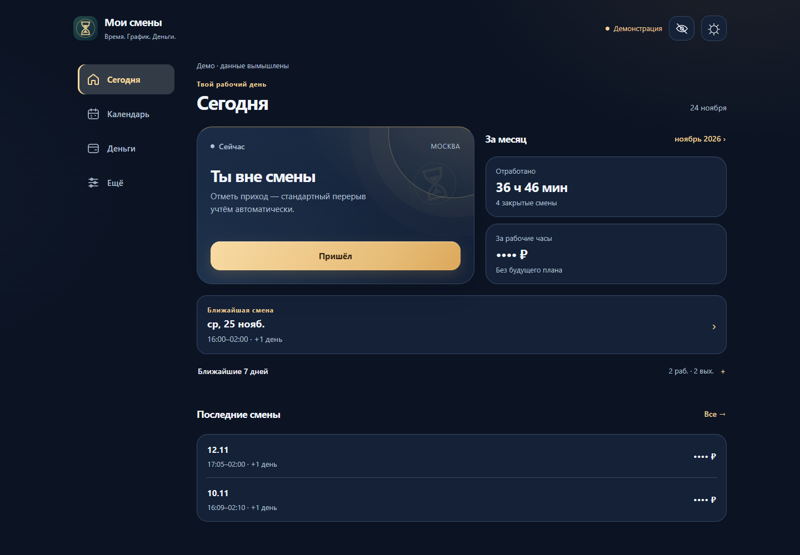
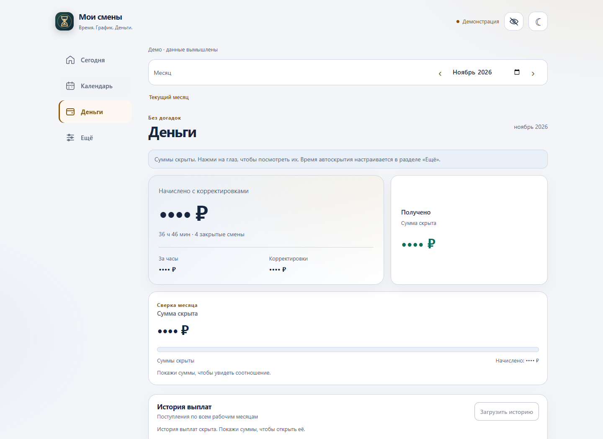
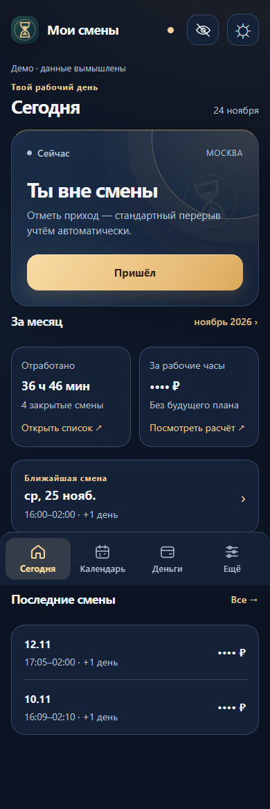
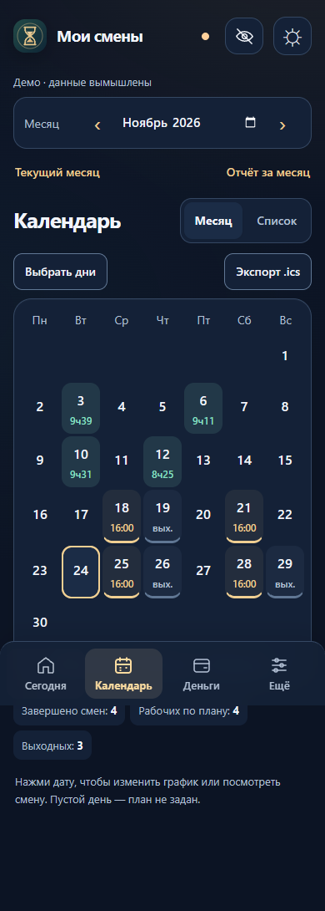
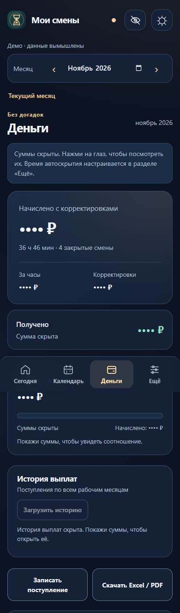
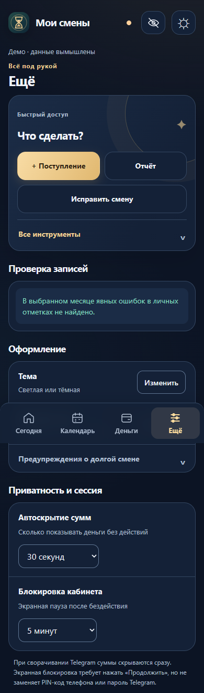
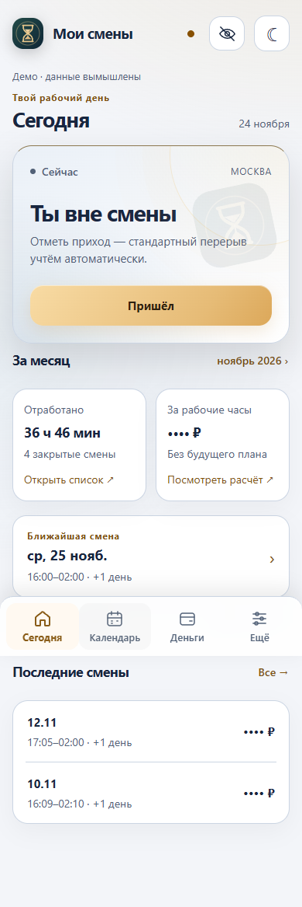
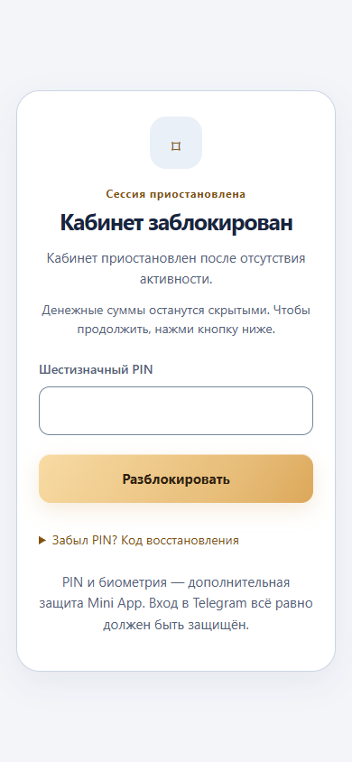

# Мои смены

**Рабочее время, смены и деньги — в одном личном кабинете.**

Telegram-бот и адаптивная Mini App для телефона и компьютера. Быстрые отметки, календарь, финансовая аналитика и дополнительные настройки приватности.

**[Открыть бота в Telegram](https://t.me/MoiSmenyBot)** · **[Что нового](CHANGELOG.md)** · **[Версия 2026.11.24](docs/RELEASE_2026_11_24.md)**

---

## Интерфейс

**Рабочий стол · Тёмная тема**

**Финансы · Светлая тема**

### Мобильная версия

<table>
<tr>
<td align="center" width="50%"> <b>Сегодня</b></td>
<td align="center" width="50%"> <b>Календарь</b></td>
</tr>
<tr>
<td align="center" width="50%"> <b>Деньги</b></td>
<td align="center" width="50%"> <b>Ещё</b></td>
</tr>
</table>

<b>Светлая тема и экран PIN-блокировки</b>

<table>
<tr>
<td align="center"> Светлая тема</td>
<td align="center"> Защита кабинета</td>
</tr>
</table>

На всех скриншотах — исключительно вымышленные записи. Реальные смены, выплаты, имена, документы и ключи не публикуются.

---

## Возможности

| Раздел | Что доступно |
|:--|:--|
| **Сегодня** | Приход и уход, живой таймер, перерывы, последние смены |
| **Календарь** | План и факт, выходные, ночные смены, исправления, экспорт в **.ics** |
| **Деньги** | Начислено, получено, остаток, ставки, премии, удержания и две части месяца |
| **История выплат** | Поиск по дате, сумме и комментарию; фильтры по рабочему месяцу и периоду |
| **Отчёты** | Excel, PDF, история изменений, сверка с офисными данными |
| **Ещё** | Быстрые действия, оформление, защита и расширенные инструменты |

### Приватность и безопасность

- **Переворот телефона.** Полное движение **экраном вверх → вниз → обратно вверх** скрывает суммы; повторный полный жест показывает их. Промежуточное положение ничего не переключает.
- **Автоскрытие.** Деньги закрываются после бездействия и сворачивания приложения.
- **PIN-код.** Добровольная дополнительная защита из шести цифр; сервер хранит только проверочный хеш, а не исходный код.
- **Биометрия.** Разблокировка через Telegram BiometricManager на совместимых устройствах; PIN остаётся резервным способом.
- **Восстановление и ограничения.** Одноразовый резервный код, ограничение неудачных попыток, защита от повторных записей и конфликтов редактирования.
- **Закрытые API.** Доступ владельца проверяется по подписи Telegram; при включённой защите дополнительно требуется сессия разблокировки.

PIN и биометрия **отключены по умолчанию** и включаются самим владельцем. PIN защищает Mini App, но не переписку Telegram и не ранее скачанные файлы. Финансовые расчёты справочные и не заменяют официальную ведомость работодателя.

---

## Запуск для разработчика

Понадобятся Python 3.11+, Node.js и собственный токен бота от [BotFather](https://t.me/BotFather).

~~~bash
python3 -m venv .venv
source .venv/bin/activate
python -m pip install -r requirements.txt

mkdir -p data
chmod 700 data
export WORKSHIFTS_DATA="$PWD/data"

read -rsp "Telegram bot token: " TELEGRAM_BOT_TOKEN; echo
export TELEGRAM_BOT_TOKEN
python bot.py
~~~

Дополнительные функции Mini App требуют собственной HTTPS-среды, проверки подписи Telegram и настройки владельца. Без Telegram-авторизации интерфейс может показывать только демонстрационный режим.

### Тестирование

~~~bash
python -m pip install -r requirements-dev.txt
python scripts/run_server_checks.py

npm ci
npm run test:browser
npm run test:design

python scripts/check_public.py
~~~

| Проверка версии 2026.11.24 | Результат |
|---|---:|
| Изолированные серверные тесты | **454 / 454** |
| Браузерные сценарии | **267 / 267** |
| Визуальные проверки | **263 / 263** |
| Тесты PIN и биометрии | **12 / 12** |

Проверены семь ширин экрана — **320–1440 px**, обе темы и ошибки в типовых сценариях. Аппаратные жесты и биометрия зависят от устройства и требуют отдельной ручной проверки.

---

## Исходный код

**Основные модули:** <code>bot.py</code> — Telegram-бот, <code>core.py</code> — хранение смен, <code>finance.py</code> — выплаты, <code>miniapp/</code> — интерфейс, <code>miniapp_server.py</code> — закрытый API, <code>security_gate.py</code> — PIN/биометрия, <code>backup.py</code> — резервирование, <code>scripts/</code> и <code>test_*.py</code> — тесты.

[Архитектура](docs/ARCHITECTURE.md) · [Безопасность](docs/SECURITY.md) · [Список изменений](CHANGELOG.md) · [Примечания к версии](docs/RELEASE_2026_11_24.md)

Мои смены · 2026.11.24

