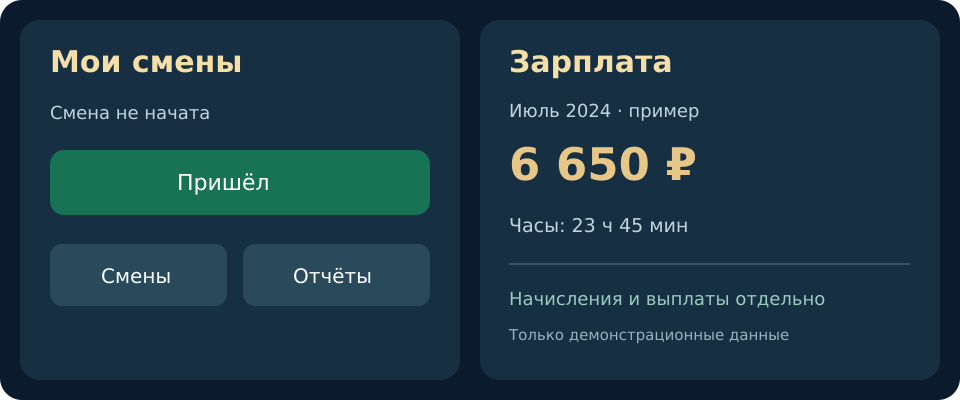

**Личный Telegram-бот для регистрации смен, расчёта зарплаты и аккуратных отчётов.**

Python · Linux · SQLite · Telegram Bot API

---

### Интерфейс

*Изображение демонстрационное. В нём нет настоящих рабочих данных.*

### Возможности

| Раздел | Что умеет |
|---|---|
| 🟢 **Приход / уход** | Записывает серверное время одной кнопкой, не дублирует события |
| 📅 **Смены** | Учитывает ночные смены, перерывы и исправления |
| 💰 **Зарплата** | Считает две части месяца, хранит историю ставок и поступлений |
| 🗓 **Календарь** | Показывает все дни месяца и открывает подробности по нажатию |
| 🗓 **План** | Показывает план отдельно от отработанных часов |
| 🏢 **Сверка** | Сопоставляет часы с подтверждёнными офисными данными |
| 📂 **Отчёты** | Создаёт красивые Excel-книги, сводки и историю изменений |
| 🔒 **Контроль** | Защищает доступ владельца, записи и секреты |

### Структура

~~~text
workshift-bot/
├── bot.py                  # Telegram-команды и маршрутизация
├── core.py                 # Работа со сменами и SQLite
├── finance.py              # Ставки, начисления и выплаты
├── finance_wizard.py       # Пошаговые финансовые настройки
├── edit_wizard.py          # Исправление времени с подтверждением
├── friendly_ui.py          # Экраны и кнопки
├── report.py               # Основная Excel-книга
├── report_catalog.py       # Дополнительные отчёты
├── office_upload.py        # Проверка входящих XLSX-файлов
├── history_schema.py       # Таблицы истории
├── backup.py               # Резервное копирование SQLite
├── docs/                   # Документация
├── deploy/                 # Linux-службы systemd
├── examples/               # Только вымышленные записи
└── test_*.py               # Автотесты
~~~

### Быстрый запуск на Linux

Нужен Python 3.11+ и отдельный токен от [BotFather](https://t.me/BotFather).

~~~bash
python3 -m venv .venv
source .venv/bin/activate
pip install -r requirements.txt

mkdir -p data
chmod 700 data
openssl rand -hex 24 > data/pair.code
chmod 600 data/pair.code

export WORKSHIFTS_DATA="$PWD/data"
export WORKSHIFTS_PAIR_FILE="$PWD/data/pair.code"
read -rsp "Telegram bot token: " TELEGRAM_BOT_TOKEN; echo
export TELEGRAM_BOT_TOKEN

python bot.py
~~~

Открой бота и отправь **/start**, затем **/pair КОД** с кодом из файла data/pair.code. После привязки файл будет удалён. Не публикуй токен и код в Git.

Для круглосуточной работы предусмотрены отдельный пользователь Linux и systemd-служба: [инструкция по установке](docs/DEPLOYMENT.md).

### Тестирование

~~~bash
python -m unittest test_core.py test_pro.py test_interactions.py test_callbacks.py test_backup.py test_security.py test_calendar.py test_workflows.py test_flow_ui.py test_miniapp.py test_miniapp_hardening.py -v
python -m compileall -q .
python scripts/check_public.py
~~~

Используются временные базы и вымышленные данные. Настоящие рабочие документы, имена, токены и серверные настройки не включены.

### Принципы безопасности

- Доступ только из личного чата привязанного владельца.
- Telegram polling без открытого входящего веб-порта.
- SQLite WAL, атомарные операции и журнал исправлений.
- Ставки вступают в силу по датам; старые начисления сохраняются.
- Excel-отчёт создаётся по запросу, исходные данные хранятся на сервере.
- Предусмотрено локальное резервное копирование; независимые копии настраиваются отдельно.

[Подробнее о безопасности](docs/SECURITY.md) · [Архитектура](docs/ARCHITECTURE.md)

> Расчёты являются справочными и не заменяют официальную ведомость работодателя.

**Статус:** практический проект с автоматическими тестами, документацией и развёртыванием на Linux.

### Графический кабинет

В папке **miniapp/** — отдельный мобильный интерфейс в тёмно-синей и золотой гамме: живой таймер, календарь с днями, финансовые карточки, график часов и контроль пропусков. Он использует ту же SQLite, что и бот.

**Режим по умолчанию — локальный предварительный просмотр.** Сервер слушает 127.0.0.1:8765, проверяет подпись Telegram и владельца перед предоставлением данных. Запись из Mini App отключена до отдельного безопасного HTTPS-развёртывания. Без Telegram открывается только вымышленный пример.

Подробнее: [архитектура и безопасный запуск Mini App](docs/MINIAPP.md).

### Последние улучшения

- Начало и завершение перерывов отдельными кнопками, без двойного вычитания старого перерыва.
- Редактирование будущего плана и выходных прямо из календаря.
- Доплаты, премии, возмещения и удержания отдельно от основного заработка.
- Проверка забытых и подозрительно длинных смен, сохранение происхождения офисных часов.
- Расширенный Excel и тесты сохранности данных.

### Надёжность графического кабинета

- Прямой выбор месяца и года, включая високосный февраль; переходы ограничены 2000–2100 годами.
- Начисления за часы разделены на две части месяца. Возмещения, доплаты и поступления остаются отдельными показателями.
- Устаревший ответ не может заменить выбранный месяц; есть тайм-аут, повторная загрузка и отдельный экран отказа в доступе.
- Просмотр использует соединение SQLite только для чтения. Повторная запись возвращает прежний результат без новой смены или перерыва; ожидаемые идентификаторы защищают от устаревших действий.
- Включены 67 серверных тестов и браузерный сценарий с 49 проверками на вымышленных данных. Он не подменяет проверку настоящим Telegram-клиентом.

Браузерные проверки требуют Node.js 22.12+:

~~~bash
npm ci
npm run test:browser
~~~

По умолчанию снимки сохраняются во временный каталог системы. Настоящие данные и токен для тестов не нужны. Подробности: [проверки и границы их покрытия](docs/TESTING.md).
